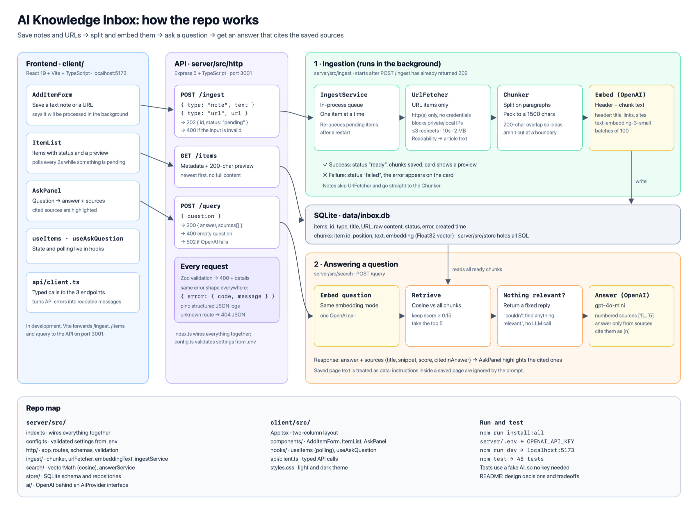

# AI Knowledge Inbox

A small app where you save notes and web links, then ask questions about them in plain English. The AI is told to answer only from what you saved, and the app shows which notes or pages each answer came from.

**Example:** you save a note saying "The beta launches on 3 December", then ask "When is the beta launching?". The app replies "3 December [1]", and source [1] is your note.



The diagram's source is [docs/repo-overview.svg](docs/repo-overview.svg).

## How it works, in plain words

1. **You save something.** A note is kept as you typed it. For a link, the app visits the page and keeps its main text (not menus or ads).
2. **The text is cut into pieces.** Long text is split into short passages of about a paragraph or two, so the app can later find the exact passage that matters.
3. **Each piece gets a "meaning fingerprint".** OpenAI turns each passage into a list of numbers (called an *embedding*) that captures what it is about. Passages about similar things get similar numbers, even if they use different words.
4. **You ask a question.** The question gets a fingerprint too, and the app finds the saved passages whose fingerprints are closest to it.
5. **The answer is written.** Those passages are given to an OpenAI model, which is told to answer only from them and to number its sources like [1] and [2].

This approach is called *retrieval-augmented generation* (RAG): first find the relevant text, then write an answer from it.

## Setting it up

### What you need

- **A computer** running macOS, Windows or Linux.
- **Node.js** version 20.17 or newer, the free program that runs this app. Version 22 is recommended. Download it from https://nodejs.org and install it like any other program.
- **An OpenAI API key**, which lets the app use OpenAI. Create one at https://platform.openai.com/api-keys. The account needs a small amount of credit. Normal testing costs a few cents.

### Step by step

1. **Download the project.** On the GitHub page, click **Code**, then **Download ZIP**, and unzip it. (If you use Git: `git clone https://github.com/rjeevan2304/Turium_AI_Knowledge_Index.git`.)
2. **Open a terminal in the project folder.** A terminal is a window where you type commands.
   - macOS: open **Terminal** and navigate to the project folder.
   - Windows: open **Powershell** and navigate to the project folder.
   - To navigate, type `cd` followed by the folder's location, for example `cd Downloads/Turium_AI_Knowledge_Index`, and press Enter.
3. **Install the app's building blocks.** Type this and press Enter. It takes a minute or two:
   ```bash
   npm run install:all
   ```
4. **Add your OpenAI key.** Make a copy of the example settings file:
   - macOS or Linux:
     ```bash
     cp server/.env.example server/.env
     ```
   - Windows:
     ```powershell
     copy server\.env.example server\.env
     ```
   Open the new `server/.env` file in any text editor (on Windows: `notepad server\.env`). Replace `sk-your-key-here` with your key and save. This file stays on your computer and is never uploaded to GitHub.
5. **Start the app:**
   ```bash
   npm run dev
   ```
6. **Open it** in your browser at http://localhost:5173.

### Using it

- **Save a note:** choose **Text note**, type or paste text, and click **Save**.
- **Save a link:** choose **URL**, paste a web address, and click **Save**.
- Each saved item shows **Processing**, then **Ready** when it can be searched, or **Failed** with the reason.
- **Ask a question** in the "Ask your inbox" box and click **Ask**. The answer shows numbers like [1], and the sources below show the matching text and a relevance score.

### Stopping and starting over

- **To stop the app,** click the terminal window and press **Ctrl+C**.
- **To start it again,** run `npm run dev`. Everything you saved is still there.
- **To delete everything you saved,** stop the app and delete the files that start with `inbox.db` in the `server/data` folder. The app creates a new, empty inbox the next time it starts.

### Common problems

| What you see | What to do |
|---|---|
| `npm` is not recognised | Node.js isn't installed, or the terminal was open before you installed it. Install Node.js, then open a new terminal. |
| The app stops with "Invalid configuration" mentioning `OPENAI_API_KEY` | The `server/.env` file or the key in it is missing. Check step 4. |
| Items fail with a 401 error | OpenAI rejected the key. Check it was copied fully. If a key is also set on your computer's system settings, that one is used instead of the file: remove it, then restart the app. |
| Items fail with a 429 error | The OpenAI account has run out of credit, or is sending too many requests. Check your credit on the OpenAI website, or wait a minute and try again. |
| A link fails with "This site blocks automated access" | Some sites, such as LinkedIn, refuse requests from apps. Save the link as a note instead. |
| Install errors mentioning `better-sqlite3` or `node-gyp` | Install Node.js 22, then run step 3 again. |
| Windows Firewall asks about Node.js | You can click Cancel. The app only accepts connections from your own computer, so it doesn't need network access. |

### Running the tests

The project includes automatic checks that don't need an OpenAI key:

```bash
npm test
```

---

## Technical details

The rest of this file is for developers and reviewers.

- **Backend:** Node.js 20+, Express 5, TypeScript, SQLite (`better-sqlite3`), OpenAI API
- **Frontend:** React 19, Vite, TypeScript (plain CSS, no UI library)

The API listens on `127.0.0.1:3001`, so only this computer can reach it (there is no login). In development, Vite serves the frontend on port 5173 and forwards `/ingest`, `/items` and `/query` to the API.

### Configuration

All settings live in `server/.env`. See `server/.env.example` for the full list.

| Variable | Default | Purpose |
|---|---|---|
| `OPENAI_API_KEY` | (required) | Used for embeddings and answers |
| `OPENAI_EMBEDDING_MODEL` | `text-embedding-3-small` | Embedding model |
| `OPENAI_CHAT_MODEL` | `gpt-4o-mini` | Model that writes the answer |
| `HOST` | `127.0.0.1` | Address the API listens on. Use `0.0.0.0` only on a network you trust, since there is no login |
| `PORT` | `3001` | API port |
| `DB_PATH` | `./data/inbox.db` | SQLite file (created on first run) |
| `RETRIEVAL_TOP_K` | `5` | Chunks passed to the model per question |
| `MIN_SIMILARITY` | `0.15` | Chunks scoring below this are ignored |
| `CHUNK_MAX_CHARS` | `1500` | Maximum chunk size |
| `CHUNK_OVERLAP_CHARS` | `200` | Text from the end of one chunk repeated at the start of the next |
| `LOG_LEVEL` | `info` | `debug`, `info`, `warn` or `error` |

If you change `PORT`, set `API_TARGET` (for example `http://localhost:4000`) when starting the frontend, so Vite forwards requests to the new port.

### API

All errors share one shape: `{ "error": { "code", "message", "details?" } }`.

**`POST /ingest`** saves a note or URL. Processing happens in the background, so it returns immediately.

```bash
curl -X POST localhost:3001/ingest -H 'content-type: application/json' \
  -d '{"type":"note","text":"Retrieval augmented generation grounds answers in saved sources."}'

curl -X POST localhost:3001/ingest -H 'content-type: application/json' \
  -d '{"type":"url","url":"https://example.com/article"}'
```

- `202 Accepted`: `{ "id", "type", "status": "pending" }`
- `400`: invalid body, an empty note, or a URL that is malformed, not http(s), or contains credentials

Fetch failures (unreachable page, blocked by the site, no readable text, private address) happen after the response. They appear on the item as `status: "failed"` with an `error` message.

**`GET /items`** lists saved items, newest first. It returns a short preview, not the full text.

```json
{
  "items": [
    {
      "id": "…", "type": "url", "title": "Article title",
      "sourceUrl": "https://example.com/article", "status": "ready",
      "error": null, "createdAt": "2026-11-17T10:00:00.000Z",
      "chunkCount": 7, "preview": "First 200 characters of the text…"
    }
  ]
}
```

**`POST /query`** answers a question.

```bash
curl -X POST localhost:3001/query -H 'content-type: application/json' \
  -d '{"question":"What grounds answers in RAG?"}'
```

```json
{
  "answer": "RAG grounds answers in the saved sources [1].",
  "sources": [
    {
      "index": 1, "itemId": "…", "title": "Note title", "sourceUrl": null,
      "chunkIndex": 0, "snippet": "…", "score": 0.61, "citedInAnswer": true
    }
  ]
}
```

- If nothing is similar enough, the answer is a fixed "couldn't find anything relevant" message with `sources: []`, and the model is not called.
- `502` means the OpenAI call failed. The message says which step failed.

### Design decisions and tradeoffs

**Chunking.** Text is split on paragraphs and packed into chunks of up to 1,500 characters (about 350 tokens). Very long paragraphs are cut at word boundaries. Each chunk starts with the last 200 characters of the previous one, so a sentence that crosses a boundary can still be found. Smaller chunks match more precisely but lose context, and larger ones blur the embedding. The overlap costs a little duplicated storage.

**Finding bare links.** A question like "my GitHub link" shares almost no words with `https://github.com/...`, so each chunk is embedded with a short header: the item title, any links, and their site names (for example `Sites: github.com`). Only the embedding input changes, not the stored text. The answer model also sees each source's URL, so it can return the link itself. This is a small heuristic. Keyword or hybrid search would handle more phrasings but goes beyond this project's scope.

**Similarity cutoff.** `MIN_SIMILARITY` is 0.15. With `text-embedding-3-small`, relevant matches in this app scored about 0.19 to 0.46, and unrelated text about 0.09, so a higher cutoff hid real matches. The model still decides whether a weak match answers the question.

**Vector store: SQLite with a full scan.** Embeddings live in the same SQLite file as the items, and each question scores every chunk. It needs no extra service and stays consistent with the items table, and for a personal inbox the scan takes milliseconds. The cost grows with the number of chunks (see below).

**Background processing.** Fetching and embedding can take seconds, so `POST /ingest` returns `202` and an in-process queue handles one item at a time. Failures are saved on the item so the frontend can show them. Pending items are re-queued on startup. A crash mid-item can lose that item's work, and the queue doesn't work across multiple servers.

**Fetching URLs.** Fetching user-supplied URLs on the server is a known risk (SSRF), so the fetcher:
- accepts only `http` and `https`, and rejects URLs with embedded credentials;
- refuses private, loopback, link-local, reserved and multicast addresses (including IPv4 addresses wrapped in IPv6, NAT64 and 6to4), checked after DNS lookup;
- follows at most 3 redirects, re-checking each one;
- stops after 10 seconds or 2 MB;
- never runs page scripts.

A DNS-rebinding attack could still change the address between the check and the connection. Closing that gap is listed under production changes.

**Prompt injection.** Fetched pages are untrusted. The system prompt tells the model that source text is data and that instructions inside it must be ignored. This reduces the risk but doesn't remove it.

**Errors and logging.** Bad input is `400` with field-level details. Malformed JSON is `400`, not `500`. OpenAI failures are `502`. Anything unexpected is logged with a stack trace and returned as a generic `500`. Logs are structured JSON from `pino`, with a request id per call.

**Code structure.** Routes only parse input and call services. Services (`IngestService`, `AnswerService`) hold the logic. Repositories hold the SQL. Only `ai/openaiProvider.ts` knows about OpenAI, behind an `AiProvider` interface, so tests use a fake. `index.ts` wires everything together.

### What breaks at scale

- **Query speed:** each question scores every chunk. Around 100,000 chunks it gets noticeably slow.
- **Memory:** all embeddings are loaded for each question.
- **Single process:** the queue, database and server share one process, so it can't run on several servers.
- **Changing the embedding model** makes stored vectors incompatible. Chunks with a different vector size are skipped with a warning in the logs, but a new model with the same size isn't detected. Either way, items need to be re-added.
- **Cost:** every question costs one embedding call and one chat call, with no caching.
- **Writes:** SQLite allows one writer at a time.

### Production changes (not implemented)

- **Storage:** Postgres with `pgvector` (or a vector database) and an approximate index such as HNSW, instead of the full scan.
- **Queue:** a durable job queue (for example BullMQ on Redis) with retries and backoff.
- **Fetching:** a connect-time address check to close the DNS-rebinding gap, per-site rate limits, and robots.txt support.
- **Search quality:** hybrid keyword and vector search, a reranker, and the embedding model version stored per chunk.
- **Answers:** streaming, and caching repeated questions.
- **Evaluation:** a labelled question set run in CI, checking retrieval and whether answers match their citations.
- **Auth and multiple users:** logins and per-user data. Left out on purpose to keep this project small.
- **Monitoring:** metrics for ingest time, failure rate, OpenAI latency and token use.
- **Performance:** keep embeddings in memory between questions, use a heap for top-k, replace the per-row chunk count with a join, and paginate `GET /items`.

### Project layout

```
server/src/
  index.ts              wires everything together
  config.ts             settings, checked on startup
  logger.ts, errors.ts  logging and error types
  ai/                   OpenAI calls, behind an AiProvider interface
  ingest/               chunking, URL fetching, background processing
  search/               similarity scoring and answering
  store/                SQLite tables and queries
  http/                 Express app, routes, input validation
client/src/
  api/client.ts         calls to the API
  hooks/                useItems (refreshes while processing), useAskQuestion
  components/           AddItemForm, ItemList, AskPanel
```

### Known limitations

- Saved items can't be edited or deleted from the app.
- Only normal web pages work. PDFs and other files are rejected.
- Some sites (such as LinkedIn) block automated requests.
- Links keep the page's text, not the original page.
- Single user, no login.
- Vite is pinned to version 6, because newer versions need a newer Node.js than 20.17.
